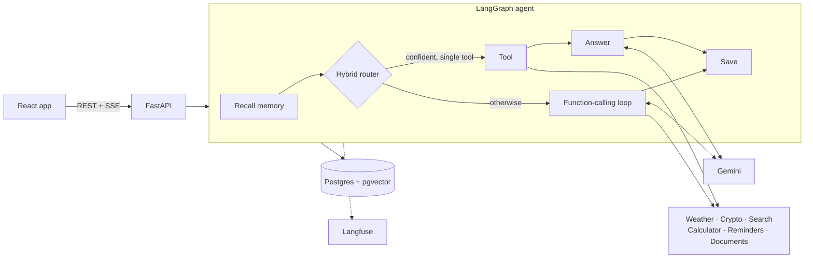

# ContextAI

**An AI assistant that shows its work.** It remembers you, checks live data and reads your PDFs, and every answer arrives with the steps it took and the sources it used.

[](https://github.com/vid6848/ContextAI/actions/workflows/ci.yml)
[](https://contextai-ahp8.onrender.com)

**[Try it live](https://contextai-ahp8.onrender.com)** (free hosting: the first visit after a quiet spell takes about a minute)


## Highlights

- **Tool-using agent.** Gemini function calling runs tools in parallel and chains them across rounds. A hybrid router answers simple requests with no planning call.
- **Visible reasoning.** A live, timed trace of memory, routing, tools and documents; each step expands to its exact input and output.
- **Ask your PDFs anything.** Whole-document summaries, page lookups, comparisons and follow-ups, with inline citations that open the exact passage. Scanned PDFs are read with Gemini vision.
- **Live data.** Weather, 5-day forecasts and air quality, crypto prices, web search and a safe calculator.
- **Long-term memory.** Facts are extracted, reconciled and editable, so "I moved to Pune" updates your city instead of contradicting it.
- **Reminders.** Natural-language scheduling in your timezone, with push notifications when no tab is open.
- **Works everywhere.** Responsive from small phones to ultra-wide screens. Use it as a guest, then sign in with Google or email and your data comes with you.

## Results

Measured by the [evaluation suite](evals/run.py) on 100 labelled requests and 25 document questions. The offline checks run on every push and fail the build on a regression.

| Measure | Result |
|---|---|
| Right tools chosen, hybrid router | **97%** |
| Right tools chosen, function calling alone | 94% |
| Requests answered with no planning call | 38%, all routed correctly, in about 3 ms |
| Right passage ranked first | 100% |
| Answers supported by their passages | 100% |
| Admits when a document doesn't cover the question | 100% |

Document results use a 10-section test handbook, so treat them as a regression check rather than a general benchmark.

## Architecture



- **Hybrid routing.** Two independent classifiers (TF-IDF and MiniLM embeddings) must agree before a request skips the model, trading a planning round of seconds for about 3 ms.
- **Built for 512 MB.** In-process ONNX embeddings, serialized PDF ingestion and a small HTTP client instead of an LLM SDK. CI fails if the container outgrows the limit.
- **One graph, two transports.** Streaming and JSON endpoints share one LangGraph, and the trace users see is the one saved with the answer and sent to Langfuse.

## Tech stack

| | |
|---|---|
| **Frontend** | React 19, TypeScript, Vite, Tailwind CSS, shadcn/ui, Zustand |
| **Backend** | FastAPI, LangGraph, Server-Sent Events |
| **AI** | Gemini, MiniLM (ONNX), hybrid retrieval and re-ranking |
| **Data and auth** | Supabase Postgres, pgvector, Supabase Auth |
| **Quality** | pytest, Vitest, evaluation suite, Langfuse, GitHub Actions |
| **Hosting** | Docker on Render |

## Getting started

Add your `GEMINI_API_KEY` to `.env`, then start it with Docker:

```bash
cp .env.example .env
docker compose up        # http://localhost:8000
```

Or run it for development with Python 3.11+ and Node 20+:

```bash
python -m venv .venv && source .venv/bin/activate
pip install -r requirements-dev.txt
uvicorn src.backend.main:app --reload --port 8000

cd frontend && npm install && npm run dev            # http://localhost:5173
```

Without a database URL it runs on SQLite and ChromaDB. Optional settings are documented in [.env.example](.env.example), and production setup is in the [deployment guide](docs/DEPLOY.md).

## Testing

```bash
ruff check src tests evals && pytest
cd frontend && npm run lint && npm run typecheck && npm test
python -m evals.run            # add --online for model-based evals
```
