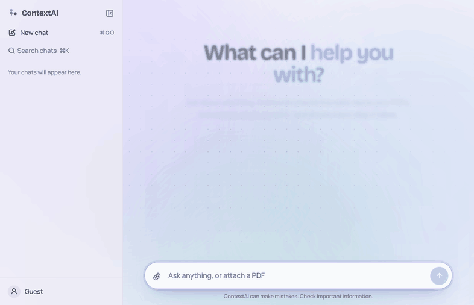
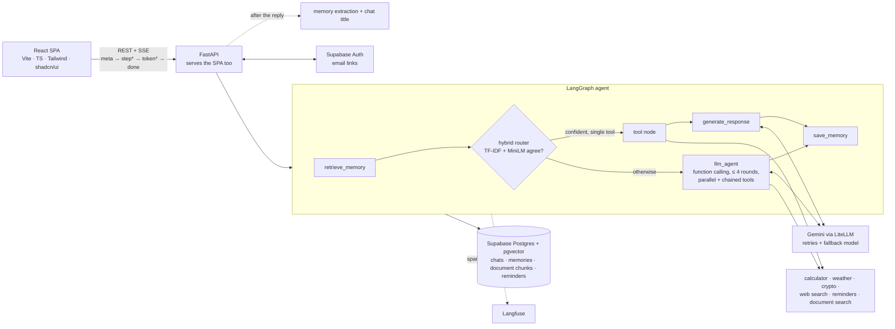

# ContextAI

**An AI assistant that shows its work.** ContextAI remembers what you tell it, checks live data, and reads your PDFs. Every answer streams in alongside the steps the agent took (memory recall, routing, tool calls, document search) and the sources it used.

**[Try it live →](https://contextai-ahp8.onrender.com)** (free instance: the first request after a quiet spell takes about a minute to wake it up)

[](https://github.com/vid6848/ContextAI/actions/workflows/ci.yml)



---

## ✨ Features

| | |
|---|---|
| **Tool-using agent** | The model picks tools itself through function calling, runs several in parallel, and chains them: "BTC and ETH prices, and how many ETH per BTC?" fetches both prices, then calls the calculator. A hybrid router fast-paths simple single-tool requests without a model call. |
| **Live agent trace** | Each answer opens with a colour-coded rail of the agent's steps: memory, routing, tools, documents, errors. Each step is timed and expands to show the exact tool input and output. |
| **Streaming chat** | Answers stream token by token over Server-Sent Events, with Stop (Esc), Regenerate, Edit-and-resend, Copy and 👍/👎 feedback. |
| **PDF Q&A with citations** | Drag a PDF into the chat and ask about it. Chunks follow the document's headings, retrieval is re-ranked (semantic + keyword), and answers cite passages inline as `[1]`; clicking one opens the exact excerpt, page and section. |
| **Live tools** | CoinGecko crypto prices and OpenWeather (shown as cards), Tavily web search (with sources and today's date for freshness), and a safe AST-based calculator. |
| **Long-term memory** | After each reply an LLM pass extracts durable facts ("Prefers Python examples") and reconciles them with what's stored: a move *updates* your city instead of contradicting it. The Memory page lets you edit or delete anything. |
| **Reminders** | "Remind me to call mom tomorrow evening" works from chat, parsed in your timezone, with browser push notifications even when no tab is open. |
| **Accounts** | Use it as a guest, or sign in with an email link to keep chats, memories and documents across devices; everything from the guest session moves into the account. |
| **Observability** | Every chat turn is a [Langfuse](https://langfuse.com) trace with a span per agent step, a generation per model call (tokens, cost, latency), and 👍/👎 recorded as a score on it. |
| **Evaluated in CI** | 100 labelled requests and 25 document questions measure routing, retrieval, answer correctness and faithfulness on every change ([results](#-evaluation)). |

---

## 🧱 Architecture



Every node runs inside a timed `agent_step` that streams `running → done/error` events through LangGraph's stream writer, records a Langfuse span, and is saved with the answer, so the trace in the UI is also the trace in the database. The same graph serves the streaming and the plain JSON endpoint. Without `DATABASE_URL`, the same stores run on SQLite + ChromaDB for local use.

---

## 📊 Evaluation

`python -m evals.run` scores the agent on [100 labelled requests](evals/intent_eval.jsonl) (expected tools, optional tools, and facts a correct answer contains) and [25 questions](evals/rag_eval.jsonl) about a [10-section handbook](evals/rag_fixture.py), 3 of which it doesn't cover. CI runs the deterministic offline part on every push and fails on a regression; the model-based part runs on pull requests.

#### Tool routing (100 labelled requests)

| Router | Picks the right tools | Model calls to decide | Decision latency p50 / p95 |
|---|---|---|---|
| TF-IDF classifier only | 73% | 0 | 0.3 / 0.4 ms |
| Gemini function calling only | 96% | 100 | 1195 / 5838 ms |
| **Hybrid (shipped)** | **97%** | 60 | 1.9 ms on the fast path, else plus a model call |

Hybrid fast path: TF-IDF and MiniLM embeddings must agree and be confident; it handles 40% of requests without a model call, 98% of them correctly (decision p50 / p95: 1.9 / 2.5 ms).

#### Document Q&A (25 questions about a 10-section handbook, 3 not covered by it)

| Metric | Result |
|---|---|
| Right passage ranked first (hit@1) | 100% |
| Right passage in the top 4 (hit@4) | 100% |
| Mean reciprocal rank | 1.00 |
| Off-topic questions gated (no passages returned) | 0% |
| Retrieval latency p50 / p95 | 88.0 / 102.4 ms |
| Answers containing the expected facts | 100% |
| Faithfulness (every claim supported by the passages, model-judged) | 100% |
| Answer relevance (model-judged) | 100% |
| Says so when the document doesn't cover it | 100% |
| Full answer latency p50 / p95 | 1360 / 6780 ms |

#### Answer correctness (12 requests with a known answer, full agent turns)

Correct: **100%**, latency p50 / p95: 9453 / 16068 ms.

Model: `gemini-3.5-flash-lite`. Results from `python -m evals.run --online` on 2026-10-28.

**What the numbers say.** Function calling alone picks the right tools 96% of the time, but every request pays for a planning round (1.2 s median, 5.8 s at p95). The hybrid router answers 40% of requests from the classifiers in about 2 ms and is slightly *more* accurate overall (97%), because the fast path rarely reaches for an unnecessary tool. The misses left are three questions about the user ("where do I live?") where the model searches documents instead of using its memories, and one reminder phrasing. Retrieval is perfect on this small handbook, but the relevance gate never fires on off-topic questions; the answer step catches all three instead.

---

## 🧭 Design decisions

- **Hybrid routing instead of always asking the model.** A planning round costs seconds. Two cheap, independent classifiers (TF-IDF + logistic regression, and nearest neighbours over MiniLM embeddings) must agree, be confident, and see only one tool's vocabulary before the fast path is taken; everything else goes to function calling. The threshold was tuned for precision on the labelled set, because a wrong fast-path pick breaks the answer.
- **One graph, two transports.** The streaming and JSON endpoints run the same LangGraph; steps go through the stream writer, which is a no-op under `invoke()`. Cancelling (Stop) sets an event the model loop checks, and the partial answer is still saved.
- **Postgres + pgvector, SQLite + Chroma behind the same interface.** Production keeps everything in Supabase so a free container can restart without losing data; local development needs no database at all. CI runs the full test suite against both.
- **Embeddings computed in-process.** MiniLM via ONNX keeps search free and private. Chroma's default embedder rebuilt the model on every call and padded every text to 256 tokens, which pushed the server past 1 GB; a shared session that pads per batch produces identical vectors at 405 MB peak, and CI fails if the container needs more than 480 MB.
- **Facts, not transcripts, as memory.** An LLM pass turns each exchange into add / update / delete operations on short facts, so "I moved to Pune" replaces the old city instead of contradicting it, and every change is visible and editable.
- **Citations that point at real text.** Chunks follow the PDF's headings, results are re-ranked with keyword coverage, and sources are numbered across all searches in a turn, so `[2]` always opens the exact excerpt the model saw.
- **Tracing that can't break answers.** Langfuse is off without keys; when on, failures are swallowed and logged, generations are closed explicitly (streams are generators), and the trace id is stored with each answer so feedback lands on the right trace.

---

## 🛠 Tech stack

| Layer | |
|---|---|
| Frontend | React 19, TypeScript, Vite, Tailwind v4, shadcn/ui, Zustand, React Router |
| API | FastAPI + Server-Sent Events |
| Agent | LangGraph, Gemini function calling with multi-tool chaining, hybrid TF-IDF + MiniLM router |
| LLM | Gemini via LiteLLM (swap providers with one env var) |
| Data | Supabase Postgres + pgvector (SQLite + ChromaDB locally), heading-aware PDF chunking, hybrid re-ranking |
| Auth | Supabase Auth (email links) with guest mode |
| Quality | pytest (204), Vitest (18), eval suite, ruff, oxlint, GitHub Actions |
| Observability | Langfuse |
| Hosting | Docker (multi-stage) on Render, Supabase |

---

## 🗺 Roadmap

Built in public over five phases, tracked with [milestones](https://github.com/vid6848/ContextAI/milestones) and [issues](https://github.com/vid6848/ContextAI/issues).

### ✅ Phase 1: Foundation & hardening
- [x] [#1](https://github.com/vid6848/ContextAI/issues/1) Server-side conversations with per-conversation history
- [x] [#2](https://github.com/vid6848/ContextAI/issues/2) Streaming chat (SSE) with live agent-step events
- [x] [#3](https://github.com/vid6848/ContextAI/issues/3) Stop, regenerate, and edit-and-resend
- [x] [#4](https://github.com/vid6848/ContextAI/issues/4) Security: user isolation, rate limits, upload limits, safe errors
- [x] [#5](https://github.com/vid6848/ContextAI/issues/5) Pinned deps, slim Docker image, CI

### ✅ Phase 2: Frontend rebuild
- [x] [#6](https://github.com/vid6848/ContextAI/issues/6) [#7](https://github.com/vid6848/ContextAI/issues/7) [#8](https://github.com/vid6848/ContextAI/issues/8) React foundation, app shell, streaming trace
- [x] [#9](https://github.com/vid6848/ContextAI/issues/9) Code highlighting, math, tables, feedback
- [x] [#10](https://github.com/vid6848/ContextAI/issues/10) Drag-and-drop PDF attachments
- [x] [#11](https://github.com/vid6848/ContextAI/issues/11) Inline citations, sources panel, weather and crypto cards
- [x] [#12](https://github.com/vid6848/ContextAI/issues/12) Landing page, shortcuts, connection banner, accessibility

### ✅ Phase 3: Smarter agent
- [x] [#13](https://github.com/vid6848/ContextAI/issues/13) LLM function calling with multi-tool chaining (hybrid router)
- [x] [#14](https://github.com/vid6848/ContextAI/issues/14) RAG upgrade: structure-aware chunking, re-ranking, document management
- [x] [#15](https://github.com/vid6848/ContextAI/issues/15) LLM-extracted long-term memory, with a Memory page
- [x] [#16](https://github.com/vid6848/ContextAI/issues/16) Natural-language reminders with notifications

### ✅ Phase 4: Accounts, persistence & deploy
- [x] [#17](https://github.com/vid6848/ContextAI/issues/17) Supabase Auth (email links) + guest mode
- [x] [#18](https://github.com/vid6848/ContextAI/issues/18) Supabase Postgres + pgvector persistence
- [x] [#19](https://github.com/vid6848/ContextAI/issues/19) Deploy (Render)

### ✅ Phase 5: Evals, observability & showcase
- [x] [#20](https://github.com/vid6848/ContextAI/issues/20) Automated evaluation suite in CI
- [x] [#21](https://github.com/vid6848/ContextAI/issues/21) Langfuse tracing
- [x] [#22](https://github.com/vid6848/ContextAI/issues/22) Demo GIF, architecture diagram, design decisions

---

## 🚀 Getting started

**Quickest:** with Docker installed, copy `.env.example` to `.env`, add your `GEMINI_API_KEY`, then

```bash
docker compose up        # http://localhost:8000
```

**For development** you need Python 3.11+ and Node 20+:

```bash
python -m venv .venv && source .venv/bin/activate
pip install -r requirements-dev.txt
cp .env.example .env                                  # add your GEMINI_API_KEY (and optional tool keys)
cd frontend && npm install && cd ..
```

Then, in two terminals (both reload on save):

```bash
uvicorn src.backend.main:app --reload --port 8000     # API on :8000, docs at /docs
cd frontend && npm run dev                            # app on http://localhost:5173
```

To run it like production (FastAPI serves the built app): `cd frontend && npm run build && cd .. && uvicorn src.backend.main:app --port 8000`.

### Environment variables

| Variable | Required | Purpose |
|---|---|---|
| `GEMINI_API_KEY` | ✅ | LLM access ([Google AI Studio](https://aistudio.google.com/)) |
| `MODEL_NAME` / `FALLBACK_MODEL_NAME` | | Any LiteLLM model string |
| `DATABASE_URL` | | Postgres with pgvector (e.g. Supabase); empty = SQLite + ChromaDB under `./data` |
| `SUPABASE_URL` / `SUPABASE_PUBLISHABLE_KEY` | | Email-link sign-in; empty = guests only |
| `TAVILY_API_KEY` / `OPENWEATHER_API_KEY` | | Web search and weather tools |
| `LANGFUSE_PUBLIC_KEY` / `LANGFUSE_SECRET_KEY` / `LANGFUSE_HOST` | | Tracing; empty = off |
| `VAPID_PUBLIC_KEY` / `VAPID_PRIVATE_KEY` / `VAPID_CONTACT` | | Push notifications for reminders (`python -m scripts.generate_vapid_keys`) |
| `ROUTER_MODE` | | `hybrid` (default), `llm` (always function calling) or `classifier` |
| `HYBRID_CONFIDENCE_THRESHOLD` / `MAX_TOOL_ROUNDS` | | Fast-path cut-off (0.35) and tool-loop limit (4) |
| `MEMORY_MODE` | | `llm` (extract facts, default) or `heuristic` (store raw messages) |
| `RATE_LIMIT_CHAT_PER_MINUTE` / `RATE_LIMIT_UPLOAD_PER_MINUTE` / `MAX_UPLOAD_MB` | | Abuse protection (defaults 20 / 5 / 10) |

### Tests, checks and evals

```bash
ruff check src tests evals && pytest                             # backend
cd frontend && npm run lint && npm run typecheck && npm test     # frontend
python -m evals.run                                              # offline evals (no API key needed)
python -m evals.run --online                                     # plus model-based evals (uses GEMINI_API_KEY)
```

---

## ☁️ Deployment

One Docker image serves the API and the React app. The free setup is **Render** for hosting and **Supabase** for the database (Postgres + pgvector) and sign-in; Render redeploys every push to `main`. Step-by-step guide: **[docs/DEPLOY.md](docs/DEPLOY.md)**.
